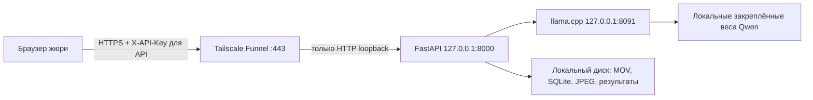

# Ноутбук участника 2: запуск и действия владельца

Состояние и результаты проверок: [приёмка ноутбука](notebook-acceptance.md). **Качество ML пока не принято; правила отключены.** Подготовка профиля и доступность сайта не означают готовность распознавания. В продолжении владелец явно поручил агенту установить Tailscale, открыть Funnel и настроить локальный запуск. Git-операции по-прежнему выполняет владелец. Текущее состояние изложено в конце отчёта приёмки.



FastAPI раздаёт сайт, Swagger и API с одного origin. Vercel для этой схемы не нужен. Порт 8091 и каталоги файлов не являются целями Funnel.

## 1. Уже подготовленная среда и отдельные данные

Использовать существующую `.venv` Python 3.12.8 и llama.cpp b11669, не менять runtime на Ollama. GPU и веса соответствуют [измеренной конфигурации](notebook-acceptance.md). Все команды ниже выполняются из корня репозитория. Пути в аргументах с пробелами заключать в кавычки.

На проверенном ноутбуке профиль находится в `C:\Users\bagwa\Documents\ForteBankDatathon\jury`; локальный `.local_data/laptop-profile-path.txt` выбирает его для всех запускателей. Прежний профиль в перенаправленном AppData сохранён. Подробности изменения и отдельного режима `/review`: [экспериментальный разбор](experimental-review.md). При первом запуске на другом компьютере:

```powershell
.\.venv\Scripts\python -m ml_tools.prepare_jury
```

Команда создаёт новый ключ только в `service.env`, пустую `data/`, `logs/`, `profile.json` и копию отключённого каталога `rules.json`. Windows ACL допускает владельца, SYSTEM и администраторов. Существующую папку команда не перезаписывает. Рабочие `.env`, `.local_data` и `.local_ml` не копируются. Для нового независимого профиля есть `--destination C:\private\jury-new`; у запускателя — соответствующий `-ProfilePath`.

`scripts/start-jury.ps1` очищает унаследованные `APP_*` на время запуска и загружает только выбранный профиль: старый ключ или `APP_DATA_DIR` из терминала не подменяет журнал жюри. При выходе окружение вызывающего PowerShell восстанавливается. Секрет не входит в аргументы процесса, JavaScript или URL.

```powershell
# Проверка среды и профиля без запуска сервера; допустима до приёмки ML:
powershell -NoProfile -ExecutionPolicy Bypass -File scripts/start-jury.ps1 -CheckOnly -InterfaceOnly
# Только локальный кабинет, с честным ready=false при отключённых правилах:
powershell -NoProfile -ExecutionPolicy Bypass -File scripts/start-jury.ps1 -InterfaceOnly
```

В продолжении API на 8000 и Qwen на 8091 запущены вместе; не запускайте второй экземпляр. Для обоих сервисов до приёмки качества добавлены [запуск и журналы](laptop-operations.md). Текущая очередь [локального разметчика](annotation-errors.md) на 8767 содержит 18 ошибок: 3 ложные тревоги и 15 пропусков относительно исходных общих меток. Старый разметчик на 8766 сохранён для прежнего черновика. Оба порта остаются вне Funnel.

Открыть `http://127.0.0.1:8000/`, взять ключ из локального `service.env`. Не копировать его в отчёты. Один ключ открывает все задачи данного профиля. **Действующий профиль `jury` больше не является пустым:** в нём сохранён контрольный запрос V16 через настоящий API. Его результат оставлен для локального просмотра.

18 октября подготовлен отдельный пустой резервный профиль `C:\Users\bagwa\Documents\ForteBankDatathon\jury-clean-20261018` с новым ключом только в его `service.env`. Проверка `start-jury.ps1 -ProfilePath <этот путь> -CheckOnly -InterfaceOnly` прошла; API с ним не запускался. В нём разрешён экспериментальный просмотр, а подтверждённые правила остаются отключёнными. Это чистое хранилище, не приёмка качества. Действующий указатель профиля, ключ и работающий сайт не переключались.

После принятия качества владелец может выбрать этот профиль для следующего входа в Windows:

```powershell
Set-Content -LiteralPath .local_data/laptop-profile-path.txt -Value 'C:\Users\bagwa\Documents\ForteBankDatathon\jury-clean-20261018' -Encoding UTF8
```

Затем выполнить полный перезапуск Windows и войти в свою учётную запись: существующий ярлык Startup прочитает новый профиль. До перезапуска уже работающий API продолжает использовать прежний профиль; после смены указателя не вызывать обычный `restart-laptop.ps1` для старого процесса, поскольку ключи различаются. Реальный холодный запуск нового профиля ещё не проверен. Для запуска без автозагрузки, когда оба порта свободны, использовать `scripts/run-laptop.ps1 -ProfilePath 'C:\Users\bagwa\Documents\ForteBankDatathon\jury-clean-20261018'`. Ключ из старого профиля в новом не действует.

## 2. Полный локальный запуск после приёмки качества

Сначала участники подтверждают типы/интервалы, применимость редакции норм и качество на независимых группах съёмки. Затем владелец помещает принятый каталог в `jury\rules.json`. Само редактирование `enabled` не является приёмкой. Перезапускать каталог между задачами, не во время обработки.

```powershell
powershell -NoProfile -ExecutionPolicy Bypass -File scripts/start-jury.ps1 -CheckOnly
powershell -NoProfile -ExecutionPolicy Bypass -File scripts/start-jury.ps1
```

Последняя команда запускает закреплённую модель и один Uvicorn на loopback. Сейчас первая команда намеренно откажет из-за отключённых кандидатов. Если модель уже работает на 8091, запускатель по умолчанию откажет. После проверки её весов и параметров владелец может явно передать `-UseExistingModel`; `/health` не доказывает версию. Такой процесс запускатель не останавливает при выходе. Новый runtime перед стартом проверяет веса, архивы и извлечённые файлы по lock без скачиваний. `--reload`, несколько Uvicorn и второй экземпляр на той же базе запрещены блокировкой данных.

Отдельная проверка закреплённых файлов, доступная и при отключённых правилах:

```powershell
powershell -NoProfile -ExecutionPolicy Bypass -File ml_tools/start_model.ps1 -Model 3.5-4b -CheckOnly
```

Для проверки API из нового терминала без печати ключа:

```powershell
# Убрать случайно унаследованный ключ; probe запросит правильный скрытым вводом.
Remove-Item Env:APP_API_KEY -ErrorAction SilentlyContinue
.\.venv\Scripts\python -m ml_tools.submission_probe --base-url http://127.0.0.1:8000 --video "C:\private\check.mov" --output .local_ml\local-check-new.json --verify-source
```

Клиент проверяет 401 без ключа, готовность, единственный POST, опрос до результата, JPEG, совпадение ссылок с серверным каталогом, журнал, повторное чтение и Range оригинала. `--verify-source` дополнительно сравнивает SHA-256 скачанного оригинала. Вывод содержит только агрегаты. HTTPS-сертификат проверяется, редиректы не выполняются, POST автоматически не повторяется. После неопределённого исхода POST сначала смотреть журнал. Сохранение ссылок подтверждает целостность каталога, а не правильность юридической квалификации.

## 3. Получение публичного URL — только владелец

Установить [официальный Tailscale для Windows](https://tailscale.com/download/windows), войти в свой tailnet. Нужны MagicDNS, HTTPS и разрешение Funnel для узла; CLI предложит подтверждение в браузере. Funnel публичен, Serve ограничен tailnet. У Funnel есть нерегулируемые ограничения полосы, поэтому скорость нужно измерить. [Требования Funnel](https://tailscale.com/docs/features/tailscale-funnel).

После принятой локальной проверки, при запущенных FastAPI и модели:

```powershell
$tailscale = 'C:\Program Files\Tailscale\tailscale.exe'
& $tailscale version
& $tailscale up
& $tailscale funnel --bg --https=443 http://127.0.0.1:8000
& $tailscale funnel status
```

Взять **фактически показанный** адрес `https://...ts.net`; Для этого ноутбука создан https://wadags-laptop.tail32787c.ts.net/; на другой машине не подставлять этот адрес вместо фактического вывода. Жюри не нужен VPN или аккаунт Tailscale. `--bg` сохраняет конфигурацию Funnel после перезапуска Tailscale; публичная раздача возобновится при доступном приложении. Для отключения только этого HTTPS-маршрута:

```powershell
& $tailscale funnel --bg --https=443 off
& $tailscale funnel status
```

Не выполнять `funnel reset` для удаления одного маршрута: он очищает всю конфигурацию Funnel. Не публиковать 8091, `.local_ml`, `.env`, диск или папку данных. [Команды, фон и отключение](https://tailscale.com/docs/reference/tailscale-cli/funnel).

С телефона через мобильный интернет при выключенном Wi-Fi открыть URL, ввести отдельный ключ и загрузить разрешённый тестовый MOV. Проверить сайт, карточку, кадры, перемотку и повторное открытие задачи. С другого компьютера вне tailnet выполнить `submission_probe` с `--base-url` фактического HTTPS-origin. Сам по себе запрос с ноутбука к собственному Funnel не заменяет другую сеть. Банковский датасет для сетевой проверки не пересылать на сторонние устройства без разрешения; для канала подходит синтетический MOV сопоставимого размера.

Лимит тела — 30 с, FFprobe — 15 с, анализ — 240 с, общий бюджет — 285 с. Самый большой имеющийся файл — 27,39 МиБ: теоретический минимум для 30 с — 7,66 Мбит/с без накладных расходов. Локальная имитация 10 Мбит/с дала загрузку 22,985 с и весь анализ 85,828 с; при 5 Мбит/с получен ожидаемый 408 примерно через 31 с без создания задачи. Пройти внешний замер с запасом. `--rate-mbps` у probe моделирует ограничение отправки локально и не измеряет Funnel. Если реальный канал медленнее, согласовать новый бюджет с участником 1: например, 60 + 15 + 220 = 295 с требует уменьшить `APP_ML_BUDGET_SECONDS`, оставить время на JPEG и заново пройти приёмку; нельзя просто увеличить upload сверх общего лимита.

## 4. Автозапуск и питание — команды владельца

Для Windows-клиента Tailscale включить **Preferences → Run unattended**, затем проверить его работу после перезапуска. Это настройка Tailscale, она не запускает FastAPI. [Официальная инструкция](https://tailscale.com/docs/how-to/run-unattended).

На этом ноутбуке настроен и фактически запущен ярлык текущего пользователя Startup: [порядок запуска, журналов и восстановления](laptop-operations.md). Планировщик здесь возвращал 1 даже на синтетической команде; диагностическая задача удалена. Ниже — альтернативная инструкция для другой Windows, а не принятый способ на этой машине. Она запускает приложение после входа владельца, не до входа. Не создавайте параллельно два способа автозапуска.

```powershell
$repo = (Get-Location).Path
$owner = [Security.Principal.WindowsIdentity]::GetCurrent().Name
$arguments = '-NoProfile -WindowStyle Hidden -ExecutionPolicy Bypass -File "{0}"' -f (Join-Path $repo 'scripts\start-jury.ps1')
$action = New-ScheduledTaskAction -Execute 'powershell.exe' -Argument $arguments -WorkingDirectory $repo
$trigger = New-ScheduledTaskTrigger -AtLogOn -User $owner
$principal = New-ScheduledTaskPrincipal -UserId $owner -LogonType Interactive -RunLevel Limited
$settings = New-ScheduledTaskSettingsSet -StartWhenAvailable -RestartCount 3 -RestartInterval (New-TimeSpan -Minutes 1) -ExecutionTimeLimit ([TimeSpan]::Zero) -MultipleInstances IgnoreNew -AllowStartIfOnBatteries -DontStopIfGoingOnBatteries
Register-ScheduledTask -TaskName 'ForteBankDatathon' -Action $action -Trigger $trigger -Principal $principal -Settings $settings
Start-ScheduledTask -TaskName 'ForteBankDatathon'
Get-ScheduledTaskInfo -TaskName 'ForteBankDatathon'
```

Задача повторяет запуск после аварийного завершения оболочки/API; это не монитор зависшей или отдельно упавшей модели. При живом API и мёртвой модели будет 503, нужен порядок восстановления ниже. Запуск до входа с отдельной учётной записью, доступом к GPU и секретам требует отдельной проверки; здесь он не заявлен. [Параметры Task Scheduler](https://learn.microsoft.com/en-us/powershell/module/scheduledtasks/new-scheduledtasksettingsset).

Подключить ноутбук к питанию, оставить крышку открытой, обеспечить охлаждение. Владелец сохраняет текущие настройки и отключает сон/гибернацию при питании от сети:

```powershell
$jury = (Get-Content -LiteralPath '.local_data\laptop-profile-path.txt' -Raw).Trim()
powercfg /query > (Join-Path $jury 'power-before.txt')
powercfg /change standby-timeout-ac 0
powercfg /change hibernate-timeout-ac 0
powercfg /query SCHEME_CURRENT SUB_SLEEP
```

На батарее настройки не меняются. Блокировка экрана допустима; выход из Windows завершает предложенную интерактивную задачу. После мероприятия вернуть прежние значения из сохранённого файла. [Powercfg](https://learn.microsoft.com/en-us/windows-hardware/design/device-experiences/powercfg-command-line-options).

## 5. Восстановление и автономная проверка

1. Сначала прочитать `/api/v1/system` и статус задачи. При `local_model_unavailable` проверить `http://127.0.0.1:8091/health`; при 429 дождаться текущей задачи. Не повторять POST из-за пропавшего ответа.
2. Для терминального запуска использовать Ctrl+C. Для фонового запуска определить владельцев портов командой `Get-NetTCPConnection -State Listen -LocalPort 8000,8091`. Перед остановкой PID сверить его путь и командную строку через `Get-CimInstance Win32_Process -Filter "ProcessId=PID"`; не завершать все Python или чужие runtime. Завершение API останавливает модель, принадлежащую его запускателю; дождаться освобождения обоих портов.
3. Перезапустить проверенный ярлык Startup или `run-laptop.ps1`. Завершённые задачи сохранятся. Прерванные перейдут в `failed`; это не отрицательный вердикт. Проверить готовность и открыть старую задачу.
4. Для резервирования остановить API и скопировать **всю** `jury\data` в новый приватный каталог: база вместе с оригиналами и кадрами. Не копировать только SQLite; не удалять активные задания. Восстановление проверять отдельно, без смешивания с журналом жюри.
5. Для холодной автономной проверки выключить Funnel, остановить API и свой runtime, отключить Wi-Fi/Ethernet, затем запустить оба локально и выполнить probe на коротком и самом длинном видео. Оставить оба процесса работающими на всё время проверки. Вернуть сеть для публичной проверки: ей нужны интернет, Tailscale, Funnel, API и runtime. Флаги offline и отсутствие внешних URL в коде не заменяют этот эксперимент.

## 6. Передача и публикация кода

Владельцу для жюри нужны URL сайта и API, отдельный ключ, перечень принятых процедур и фактические ограничения. Ключ передаётся отдельно от публичных материалов. Сейчас перечень принятых ML-процедур пуст.

Локальные изменения подготовлены без коммита и push. HEAD остался на `f2a42eb`, но рабочие файлы уже содержат обновления `origin/main` до `58dec8b` (в последнем коммите изменён только README). Поэтому обычный diff показывает также чужое обновление, а новые файлы из него пока числятся untracked относительно старого HEAD. Перед Git-операциями сохранить локальную работу; не выполнять слепой checkout/reset/clean. Итоговый patch хранится в `.local_data/scratch/notebook-readiness/notebook-readiness-v2.patch`, базой служит `58dec8b`. Перед применением выполнить `git apply --check` на чистом checkout; не применять patch повторно к уже изменённым файлам. Включать только код, тесты и документацию. После новых обновлений повторить затронутые проверки. Данные, service.env, результаты и веса в Git не добавлять; force push не нужен.
